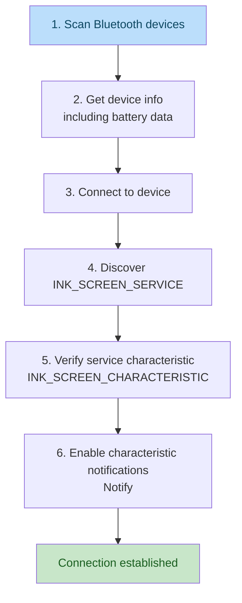
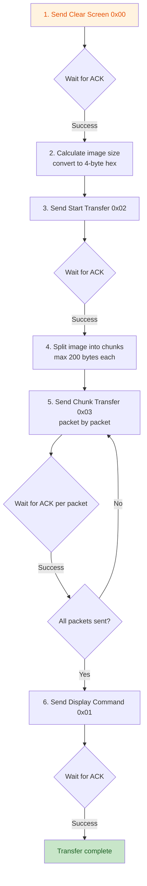
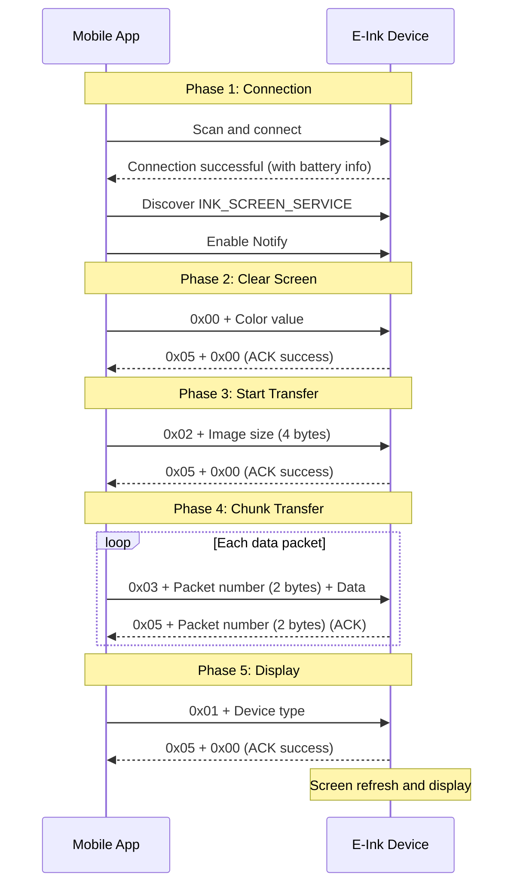

# E-Ink Screen Bluetooth Transfer Protocol Specification

> **Version**: v1.0  
> **Date**: 2026-08-08  
> **Status**: Released  

---

## Table of Contents

1. [Overview](#1-overview)
2. [Service and Characteristics](#2-service-and-characteristics)
3. [Command Definitions](#3-command-definitions)
4. [Protocol Flow](#4-protocol-flow)
5. [Image Data Conversion](#5-image-data-conversion)
6. [Technical Parameters](#6-technical-parameters)
7. [Error Handling](#7-error-handling)
8. [Device Model Types](#8-device-model-types)
9. [Test Data](#9-test-data)

---

## 1. Overview

This protocol defines the communication specification for image transmission to Electronic Paper Displays (EPD) via Bluetooth Low Energy (BLE). The protocol adopts a GATT-based (Generic Attribute Profile) Bluetooth service architecture, focusing on reliable image data transmission and display control.

### 1.1 Scope

- Bluetooth refresh operations for Electronic Shelf Labels (ESL)
- Bluetooth communication between base stations and labels
- Direct Bluetooth communication between mobile apps and labels

### 1.2 Glossary

| Term | Description |
|------|-------------|
| EPD | Electronic Paper Display |
| GATT | Generic Attribute Profile |
| ACK | Acknowledge Character |
| MTU | Maximum Transmission Unit |
| BWR | Black / White / Red (3-color display) |
| BWRY | Black / White / Red / Yellow (4-color display) |

---

## 2. Service and Characteristics

### 2.1 Service UUID

| Name | UUID |
|------|------|
| INK_SCREEN_SERVICE | `13187b10-eba9-a3ba-044e-83d3217d9a38` |

### 2.2 Characteristic UUID

| Name | UUID | Properties |
|------|------|------------|
| INK_SCREEN_CHARACTERISTIC | `4b646063-6264-f3a7-8941-e65356ea82fe` | Write + Notify |

### 2.3 Battery Service UUID

| Name | UUID |
|------|------|
| Battery Service | `0000181A-0000-1000-8000-00805F9B34FB` |

---

## 3. Command Definitions

### 3.1 Command Summary

| Command | Code | Direction | Data Format |
|---------|------|-----------|-------------|
| Clear Screen | `0x00` | App → Device | `0x00` + Color value (1 byte) |
| Display | `0x01` | App → Device | `0x01` + Device type (1 byte) |
| Start Transfer | `0x02` | App → Device | `0x02` + Image size (4 bytes) |
| Chunk Transfer | `0x03` | App → Device | `0x03` + Packet number (2 bytes) + Data |
| ACK | `0x05` | Device → App | `0x05` + Packet number (2 bytes) or `0x05` + `0x00` |

### 3.2 Clear Screen Command (0x00)

- **Purpose**: Clear the screen and fill with specified color
- **Data Format**: `0x00` + Color value

| Color | Hex Value |
|-------|-----------|
| White | `0xFF` |
| Black | `0x00` |

**Example**: Clear screen to white → Send `00 FF`

### 3.3 Start Transfer Command (0x02)

- **Purpose**: Notify device to prepare for image data reception
- **Data Format**: `0x02` + Image size (4 bytes, big-endian)

**Example**: Image size 9472 bytes → Send `02 00 00 25 00`

### 3.4 Chunk Transfer Command (0x03)

- **Purpose**: Transmit image chunk data
- **Data Format**: `0x03` + Packet number (2 bytes, big-endian) + Data payload

**Constraint**: Maximum 200 bytes per packet (including command code + packet number + data)

### 3.5 Display Command (0x01)

- **Purpose**: Notify device to display the received image data on screen
- **Data Format**: `0x01` + Device type (1 byte)

**Example**: 2.13" BWR display → Send `01 03`

### 3.6 ACK Command (0x05)

- **Purpose**: Device acknowledgment for received data
- **Data Format**:
  - Chunk transfer ACK: `0x05` + Packet number (2 bytes)
  - Other command ACK: `0x05` + Status code (1 byte)

| Status Code | Meaning |
|-------------|---------|
| `0x00` | Success |
| Other | Failure |

---

## 4. Protocol Flow

### 4.1 Connection Establishment



### 4.2 Data Transmission



### 4.3 Device Response Handling

| Scenario | ACK Format | Description |
|----------|------------|-------------|
| Chunk transfer ACK | `0x05` + Packet number (2 bytes) | Matching packet number indicates success |
| Other command ACK | `0x05` + `0x00` | `0x00` = success, other = failure |
| No response (timeout) | None | No ACK within 2 seconds = failure |

---

## 5. Image Data Conversion

### 5.1 Conversion Overview

Before transmission, images must be converted from Base64-encoded PNG format to the E-Ink specific hexadecimal format. The conversion process: Base64 decode → Image rotation → 4-color pixel packing → Hex string output.

### 5.2 Color Encoding Map

The E-Ink display uses 2-bit encoding for each pixel color, with 4 pixels packed into 1 byte:

| Color | 2-bit Code | RGB Value |
|-------|------------|-----------|
| Black | `00` | RGB(0, 0, 0) |
| White | `01` | RGB(255, 255, 255) |
| Yellow | `10` | RGB(255, 255, 0) |
| Red | `11` | RGB(255, 0, 0) |

### 5.3 Image Rotation Rules

Rotation is automatically determined based on image width:

| Condition | Action |
|-----------|--------|
| Width ≥ 400px | No rotation |
| Width < 400px and Width < Height | No rotation |
| Width < 400px and Width ≥ Height | Rotate 90° counterclockwise, then 180° |

### 5.4 Pixel Packing Rule

Every 4 pixels are packed into 1 byte in left-to-right, top-to-bottom order:

```
byte_value = (pixel1 << 6) | (pixel2 << 4) | (pixel3 << 2) | pixel4
```

**Example**: 4 white pixels → `(01<<6)|(01<<4)|(01<<2)|01` = `01010101` = `0x55`

### 5.5 Java Implementation Reference

**Core Method**: `convertPureColorBase64ToEInkHex(String base64PNG)`

**Conversion Flow**:

```java
// 1. Remove Base64 prefix and decode to image bytes
if (base64PNG.contains(";base64,")) {
    base64PNG = base64PNG.substring(base64PNG.indexOf(";base64,") + 8);
}
byte[] imageBytes = Base64.getDecoder().decode(base64PNG);
BufferedImage image = ImageIO.read(new ByteArrayInputStream(imageBytes));

// 2. Apply rotation logic
BufferedImage processedImage = applyRotationLogic(image);

// 3. Convert to 4-color bitmap data (4 pixels per byte)
byte[] einkData = convertTo4PixelsPerByte(processedImage);

// 4. Convert to hex string
String hexString = bytesToHex(einkData);
```

**Color Detection Logic** (strict pure-color matching):

```java
// Black: R=0x00, G=0x00, B=0x00
// White: R=0xFF, G=0xFF, B=0xFF
// Red:   R=0xFF, G=0x00, B=0x00
// Yellow: R=0xFF, G=0xFF, B=0x00
// Other colors default to white
```

**Image Rotation Method** `applyRotationLogic`:

```java
private static BufferedImage applyRotationLogic(BufferedImage original) {
    int width = original.getWidth();
    int height = original.getHeight();

    // Determine whether to rotate based on C++ logic
    if (width >= 400) {
        // No rotation, return directly
        return original;
    } else {
        if (width < height) {
            // No rotation
            return original;
        } else {
            // Rotate: 90 degrees counterclockwise
            BufferedImage rotated = new BufferedImage(height, width, original.getType());

            for (int y = 0; y < height; y++) {
                for (int x = 0; x < width; x++) {
                    int rgb = original.getRGB(x, y);
                    // 90° counterclockwise: new position (y, width-1-x)
                    rotated.setRGB(y, width - 1 - x, rgb);
                }
            }

            // Then rotate 180 degrees
            BufferedImage rotated180 = new BufferedImage(height, width, original.getType());
            for (int y = 0; y < width; y++) {
                for (int x = 0; x < height; x++) {
                    int rgb = rotated.getRGB(x, y);
                    // 180° rotation: new position (height-1-x, width-1-y)
                    rotated180.setRGB(height - 1 - x, width - 1 - y, rgb);
                }
            }

            return rotated180;
        }
    }
}
```

**Pixel Packing Method** `convertTo4PixelsPerByte`:

```java
private static byte[] convertTo4PixelsPerByte(BufferedImage image) {
    int width = image.getWidth();
    int height = image.getHeight();
    int totalPixels = width * height;

    // Calculate required bytes (4 pixels per byte)
    int bytesNeeded = (totalPixels + 3) / 4;
    byte[] result = new byte[bytesNeeded];

    // First extract all pixel color values
    int[] colorValues = new int[totalPixels];
    int index = 0;
    for (int y = 0; y < height; y++) {
        for (int x = 0; x < width; x++) {
            int rgb = image.getRGB(x, y);
            colorValues[index++] = rgbToTwoBitColor(rgb);
        }
    }

    // Pack every 4 pixels into 1 byte
    // value = (temp[i+0] << 6) | (temp[i+1] << 4) | (temp[i+2] << 2) | temp[i+3]
    for (int i = 0, j = 0; i < totalPixels; i += 4, j++) {
        // Ensure no out-of-bounds
        int p1 = (i < totalPixels) ? colorValues[i] : COLOR_WHITE;
        int p2 = (i + 1 < totalPixels) ? colorValues[i + 1] : COLOR_WHITE;
        int p3 = (i + 2 < totalPixels) ? colorValues[i + 2] : COLOR_WHITE;
        int p4 = (i + 3 < totalPixels) ? colorValues[i + 3] : COLOR_WHITE;

        // Follow C++ code order: p1 in highest bits, p4 in lowest bits
        byte value = (byte) ((p1 << 6) | (p2 << 4) | (p3 << 2) | p4);
        result[j] = value;
    }

    return result;
}
```

---

## 6. Technical Parameters

### 6.1 Transfer Parameters

| Parameter | Value |
|-----------|-------|
| Image data format | Base64 encoded |
| Image data format (transmitted) | Hexadecimal string |
| Max bytes per packet | 200 bytes |
| Packet number range | 0 - 65535 |
| ACK timeout | 2 seconds |
| Color bit depth | 2 bits/pixel (4 colors) |
| Pixel packing | 4 pixels/byte |

### 6.2 Battery Level Reading

Battery information is read from the `serviceData` property in Bluetooth advertising packets:

- **Service UUID**: `0000181A-0000-1000-8000-00805F9B34FB`
- **Data Type**: ArrayBuffer
- **Battery Position**: Bytes 18-19 (as hex string)
- **Conversion**: Hex to decimal, result is battery percentage

**JavaScript Example**:

```javascript
let power = 0;
const buf = v.serviceData[uuid];
if (buf) {
    const hex = ab2hex(buf);
    if (hex.length >= 20) {
        power = hexToDecimal(hex.substring(18, 20));
        console.log(power);
    }
}

// ArrayBuffer to hex string
const ab2hex = buffer =>
    Array.prototype.map
        .call(new Uint8Array(buffer), b => ('00' + b.toString(16)).slice(-2))
        .join('');

// Hex to decimal
const hexToDecimal = hex => {
    if (hex.length !== 2) throw new Error('Invalid parameter!');
    const map = {
        0: 0, 1: 1, 2: 2, 3: 3, 4: 4, 5: 5, 6: 6, 7: 7,
        8: 8, 9: 9, a: 10, b: 11, c: 12, d: 13, e: 14, f: 15
    };
    return map[hex[0].toLowerCase()] * 16 + map[hex[1].toLowerCase()];
};
```

---

## 7. Error Handling

### 7.1 Timeout Retransmission

| Mechanism | Description |
|-----------|-------------|
| ACK timeout | 2 seconds |
| Retransmission strategy | Resend current packet on timeout, simplified retransmission |
| Max retry count | Recommended 3 times |

### 7.2 Data Integrity

| Mechanism | Description |
|-----------|-------------|
| Packet number | Ensures correct data order, range 0-65535 |
| ACK confirmation | Wait for ACK after each packet for reliable transmission |
| Sequence validation | Device-returned packet number must match sent packet number |

### 7.3 Exception Handling Recommendations

| Exception Scenario | Handling |
|---------------------|----------|
| Bluetooth disconnection | Reconnect and restart transmission from beginning |
| ACK timeout | Resend current packet; terminate after max retries |
| Packet number mismatch | Terminate transmission and restart |
| Image data corruption | Re-convert image data and retry |

---

## 8. Device Model Types

### 8.1 Device Type Code Table

| Enum Name | Size ID | Type Code | Description |
|-----------|---------|-----------|-------------|
| BWR_154 | 1.54_BWR | `0x01` | 1.54" Black/White/Red |
| BWRY_154 | 1.54_BWRY | `0x02` | 1.54" Black/White/Red/Yellow |
| BWR_213 | 2.13_BWR | `0x03` | 2.13" Black/White/Red |
| BWRY_213 | 2.13_BWRY | `0x04` | 2.13" Black/White/Red/Yellow |
| BW_213 | 2.13_BW | `0x03` | 2.13" Black/White |
| BWR_266 | 2.66_BWR | `0x05` | 2.66" Black/White/Red |
| BWRY_266 | 2.66_BWRY | `0x06` | 2.66" Black/White/Red/Yellow |
| BWR_290 | 2.90_BWR | `0x07` | 2.90" Black/White/Red |
| BWRY_290 | 2.90_BWRY | `0x08` | 2.90" Black/White/Red/Yellow |
| BWR_350 | 3.50_BWR | `0x09` | 3.50" Black/White/Red |
| BWRY_350 | 3.50_BWRY | `0x0A` | 3.50" Black/White/Red/Yellow |
| BWR_420 | 4.20_BWR | `0x0B` | 4.20" Black/White/Red |
| BWRY_420 | 4.20_BWRY | `0x0F` | 4.20" Black/White/Red/Yellow |
| BWR_750 | 7.50_BWR | `0x0D` | 7.50" Black/White/Red |
| BWRY_750 | 7.50_BWRY | `0x10` | 7.50" Black/White/Red/Yellow |

> **Note**: `BW_213` (2.13" Black/White) and `BWR_213` (2.13" Black/White/Red) share the same type code `0x03`.

---

## 9. Test Data

### 9.1 Test Base64 Image

The following Base64 data can be used directly for testing. It is a fully white image:

```
data:image/png;base64,iVBORw0KGgoAAAANSUhEUgAAASgAAACACAYAAAC4P/QuAAACwUlEQVR42u3dUU7DMBBF0ex/02UF0Dh+M5mEcyR+UFtcO76tEgrHB2CowxQAAgUgUIBAAQgUIFAAAgUgUIBAAQgUIFAAAgUgUIBAAQgUIFAAAgUgUIBAAQgUIFAAAgUgUIBAAQgUIFAAAgUgUIBAAQgUIFAAAgUIFIBAAQgUIFAAAgUIFIBAAQgUIFAAAgUIFIBAAQgUIFAAAgUIFIBAAQgUIFAPnpTj+PXryu3uHueEse6Op/r2bzs2BUqgBEqgBEqgBEqgBEqgECiBEiiBEiiB+ntMK2NfDdR/OTYFSqAEasA8T1wXgRKo1wRq5/6dgarYFFMD1bEmK+/+BIr2QJ3ZdN8epyNQiXE+JVBda3L1eQoULYE6uxG+PVZ1oFLjfEKgutZk93kKFKM2QupKVfKxU5tkSqC61uTsuyqBEiiBEiiBEiiB2jk/kYxO+raVFwg6A9W5JomfIVCUvZoJ1Pk5qQjU3WsiUAIlUAIlUAIlUALVcx7qynwLlEAJVMMJVIH6LM/P5BeNxAUPgUKghgdq9fuTAtV9YUagBEqgBGp7XgRKoGKb5urBIlACJVAC9chAVY5ToARKoARKoMKBSoVLoARKoPyaQcmHhlMfrt1Za4ESKIESKIESKIESKIESKIESKIESKIESKIESKIESKIESKIESKIF6c6BWN9Xb/2DdhEDduSaJMQiUQAnUkECl7ytQAiVQgYNxd5xdMa2a891Apd/FpdYkHSmBEqj2gzExzo5AVc75tECl1mR1DM5B0X7C8gn/uLNjU9wdqNRzrTgmnCQHECgAgQIECkCgAIECECgAgQIECkCgAIECECgAgQIECkCgAIECECgAgQIECkCgAIECECgAgQIECkCgAIECEChAoAAECkCgAIECEChAoAAECkCgAIECEChAoAAECkCgAIECEChAoAAECkCggAf5AWNisJBg26MkAAAAAElFTkSuQmCC
```

### 9.2 Converted Hex Data

```
555555555555555555555555555555555555555555555555555555555555555555555555555555555555555555555555555555555555555555555555555555555555555555555555555555555555555555555555555555555555555555555555555555555
```

> **Explanation**: `0x55` = `01010101`, which is the packed value of 4 white pixels. A fully white image will have all bytes as `55` after conversion.

---

## Appendix

### A. Protocol Interaction Sequence Diagram




